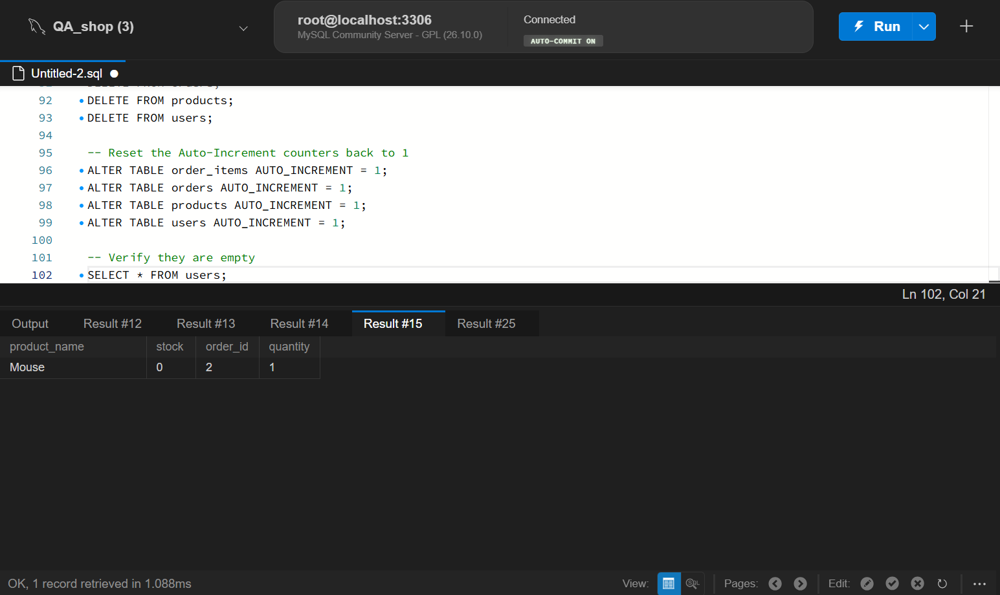

# BUG-001: System allows ordering products with zero stock

**Severity:** High
**Priority:** High
**Status:** Open

## Description
The application allows a user to place an order for a product even when the product's inventory is zero. This violates inventory rules and could lead to unfulfillable orders.

## Steps to Reproduce
1. Open the `qa_shop` database.
2. Run the SQL query found in `database/bug_verification.sql`.

## Expected Result
The query should return `0 rows`. The system should block the order.

## Actual Result
The query returns `1 row`. Product "Mouse" (stock = 0) is attached to Order ID 2.

## Attachments

